# PulseFit

A personal fitness tracker built from the PulseFit Figma design (`ziahdesign` → page "PulseFit — Fitness App"). With it you can:

- browse guided workouts and the exercise library, and build your own workouts;
- run a session with hold and rest timers;
- log sets, review your history and weekly activity;
- track goals and body measurements.

**Stack:** Next.js 16 (App Router) · React 19 · TypeScript (strict) · Tailwind CSS v4 · Supabase (Postgres, Auth, Row Level Security) · Zod · Vitest · Playwright · Lucide icons.

> PulseFit is a fitness tracker, not a medical tool. Energy values are labelled estimate ranges, and statistics are for motivation only. Nothing connects to wearables or health platforms.

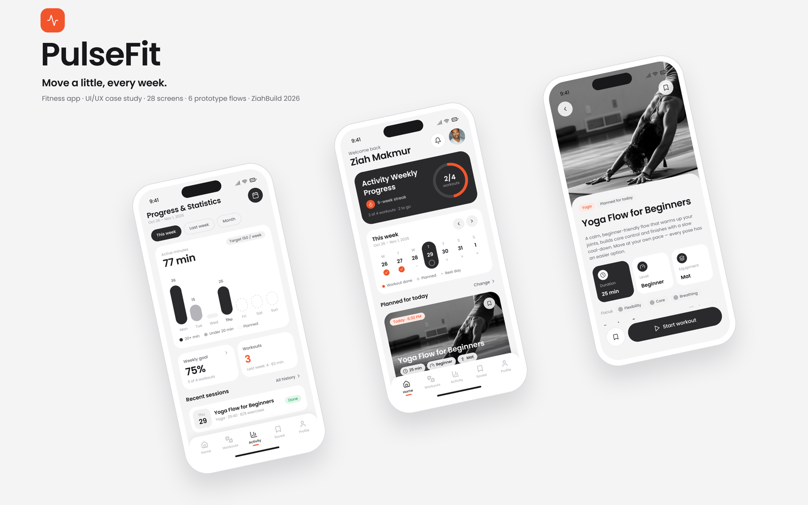

## Screens

The screens below are the design frames from the Figma export (`PulseFit_Portfolio_Export_v2.zip`, scaled to 1×). Each one is implemented at the route shown under it, using real data from Supabase.

### Onboarding & home

| Welcome | Choose your focus | Home | Home — after workout |
| :---: | :---: | :---: | :---: |
| 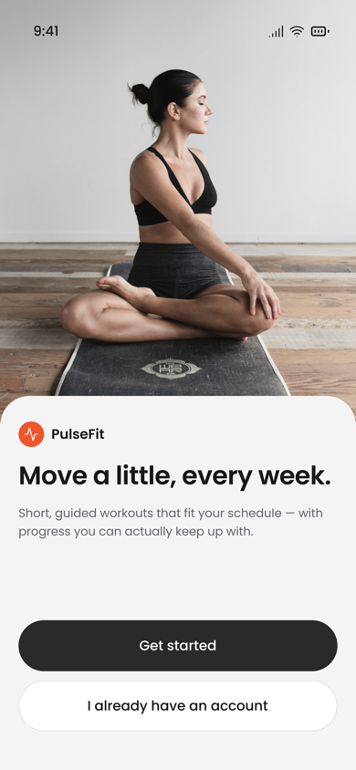 | 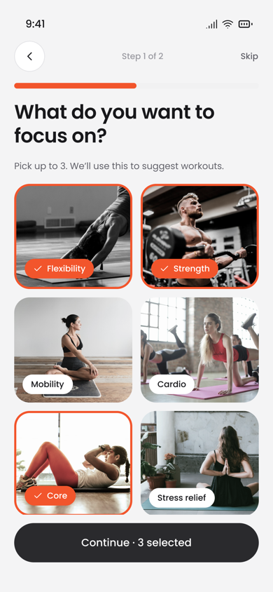 | 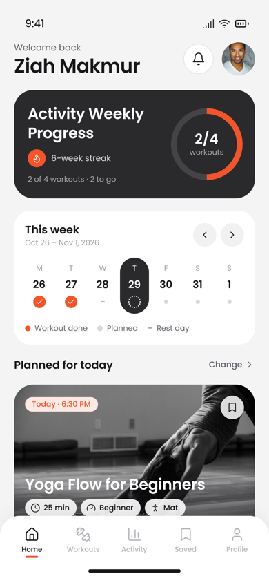 | 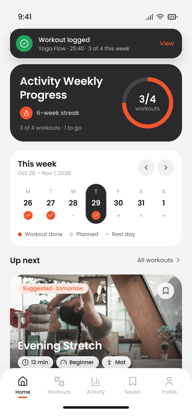 |
| `/welcome` | `/onboarding` | `/home` | `/home` |

### Discover workouts

| Workouts | Workouts — Yoga | Workout details | Details — saved |
| :---: | :---: | :---: | :---: |
| 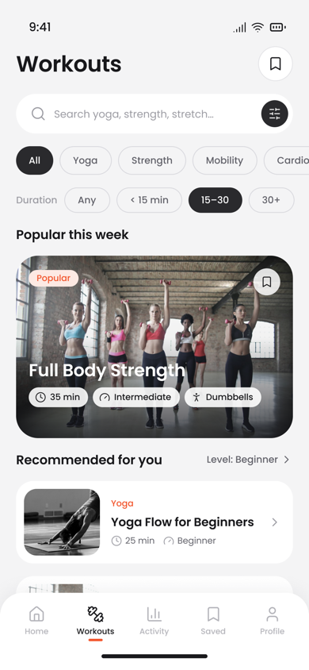 | 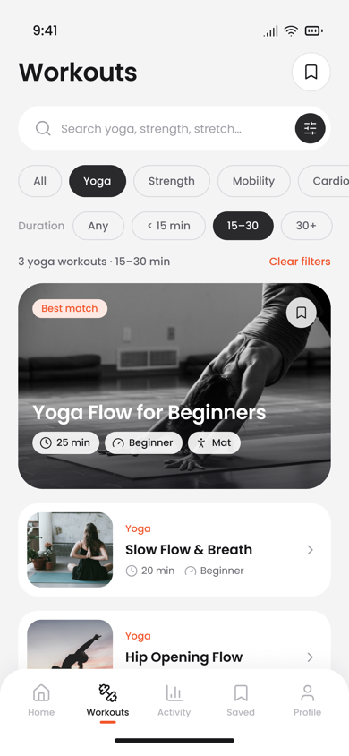 | 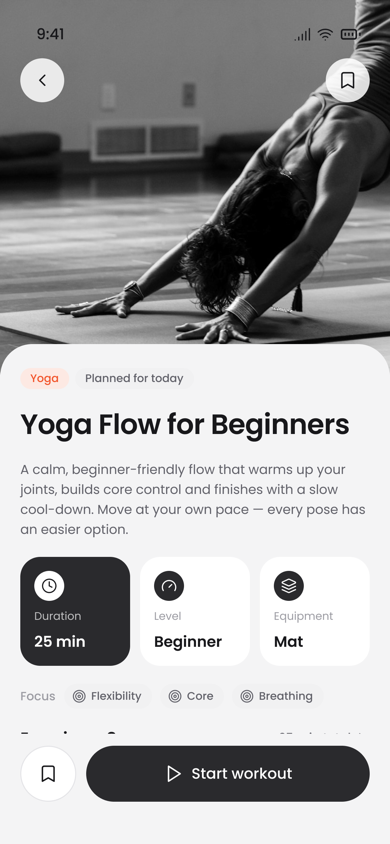 | 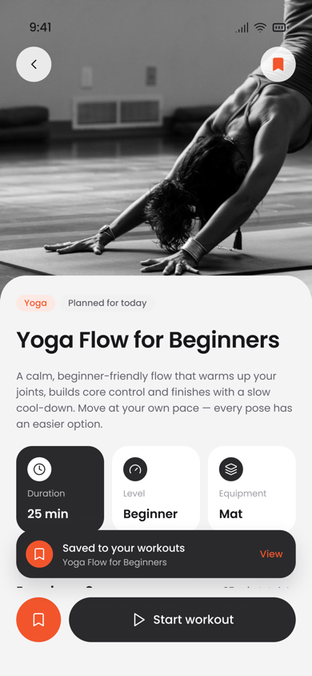 |
| `/workouts` | `/workouts?cat=yoga` | `/workouts/[id]` | `/workouts/[id]` |

### Workout session

| Active workout | Paused | Rest | End workout? |
| :---: | :---: | :---: | :---: |
| 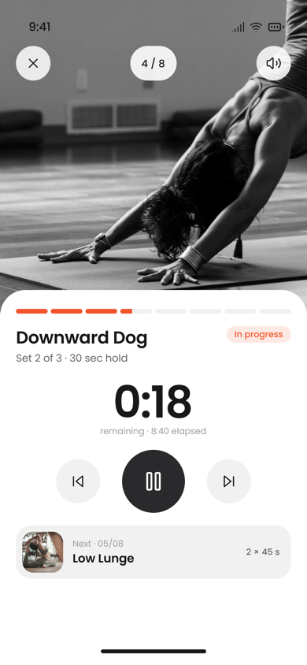 | 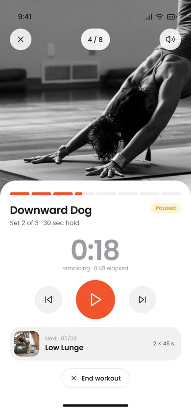 | 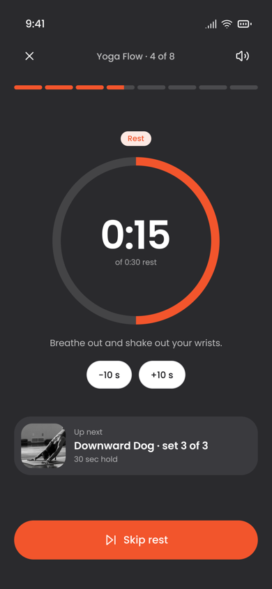 | 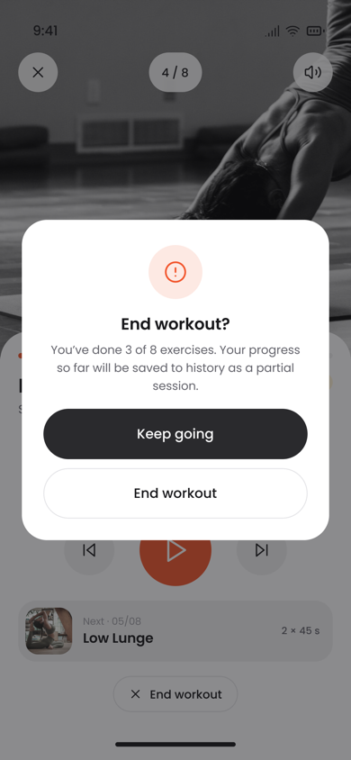 |
| `/session/[id]` | `/session/[id]` | `/session/[id]` | `/session/[id]` |

| Final exercise | Workout complete |
| :---: | :---: |
| 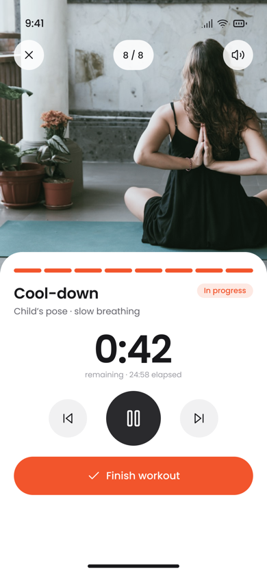 | 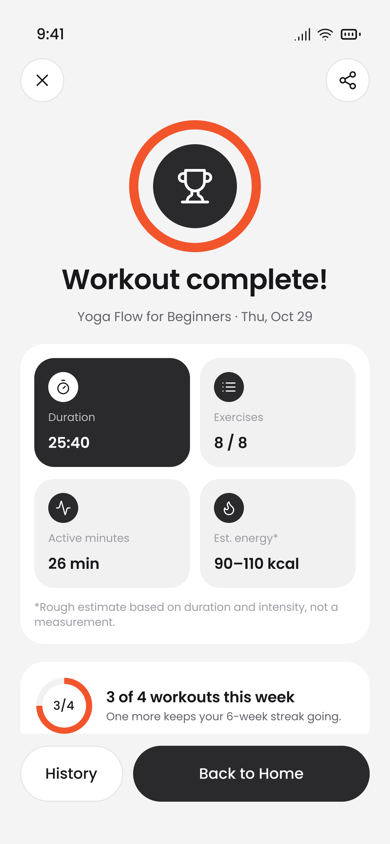 |
| `/session/[id]` | `/session/[id]/complete` |

### Activity & history

| Activity | Select period | Workout history | History — empty filter | Session details |
| :---: | :---: | :---: | :---: | :---: |
| 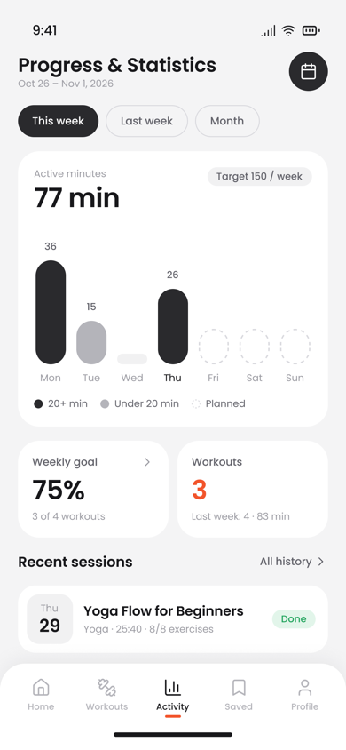 | 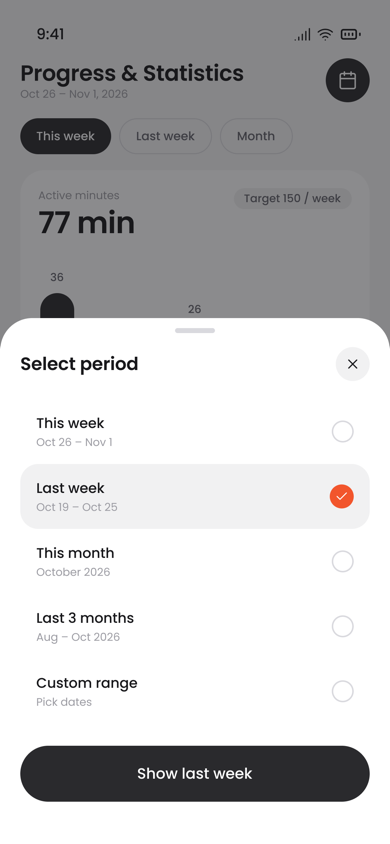 | 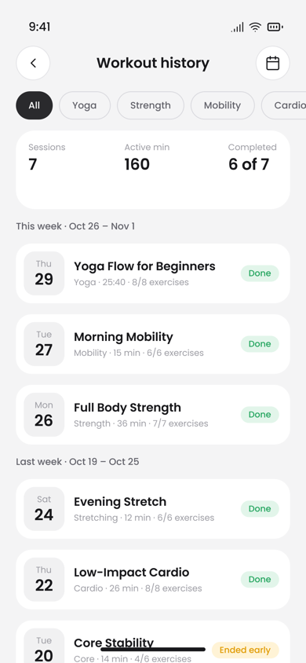 | 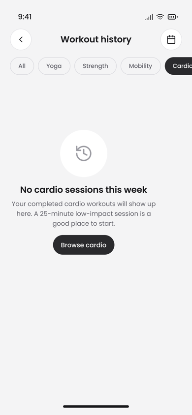 | 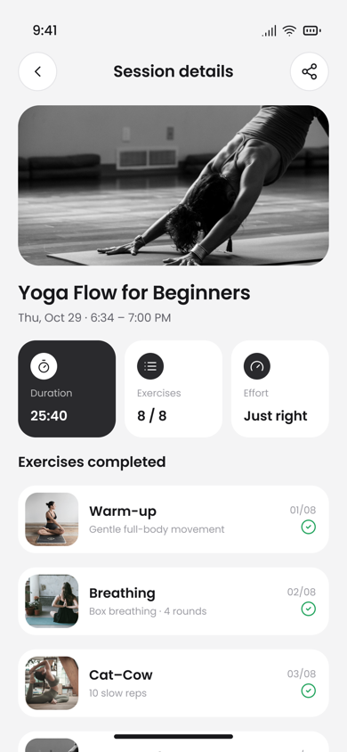 |
| `/activity` | period sheet | `/history` | `/history?cat=…` | `/history/[id]` |

### Goals, saved & profile

| Fitness goals | Edit goal | Goals — updated | New goal |
| :---: | :---: | :---: | :---: |
| 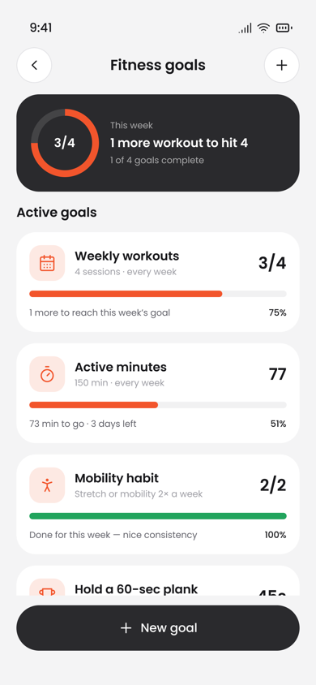 | 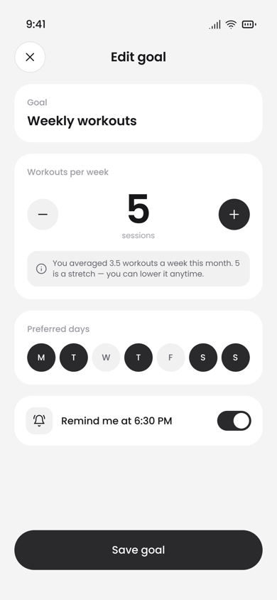 | 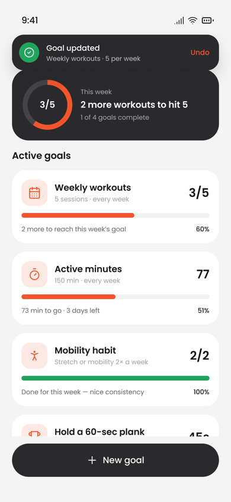 | 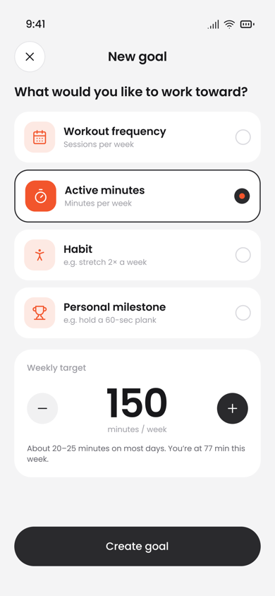 |
| `/goals` | `/goals/[id]` | `/goals` | `/goals/new` |

| Saved | Saved — empty | Saved — removed (Undo) | Profile | Notifications |
| :---: | :---: | :---: | :---: | :---: |
| 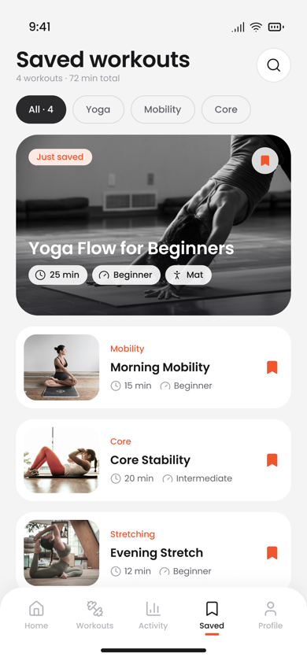 | 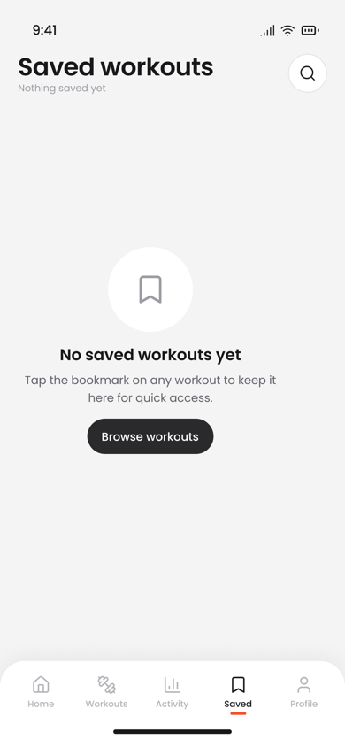 | 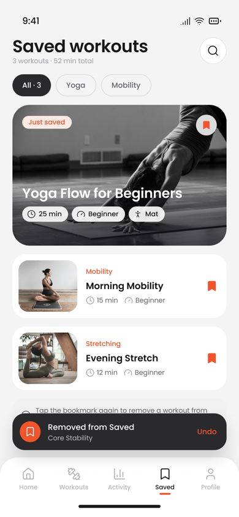 | 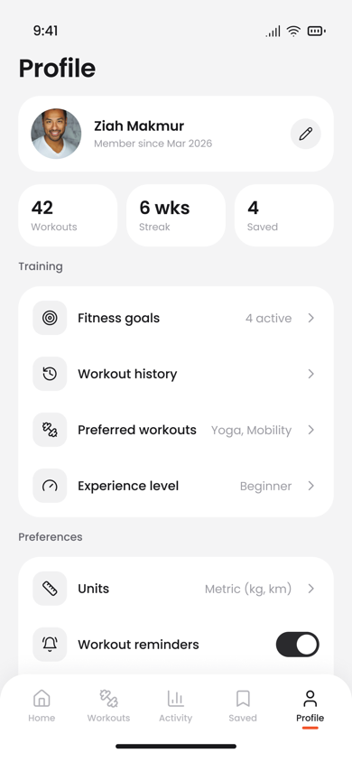 | 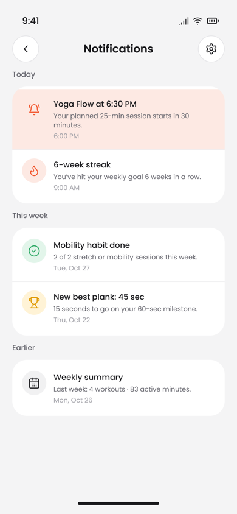 |
| `/saved` | `/saved` | `/saved` | `/profile` | `/notifications` |

There is no Figma frame for the exercise library (`/exercises`), the workout builder (`/workouts/new`), body measurements (`/measurements`), sign-in/sign-up or profile edit. Those screens reuse the same tokens and components.

---

## Quick start (local)

Requirements: Node 20+ and Docker (for the local Supabase stack).

```bash
npm install
npm run db:start          # starts local Supabase, applies migrations + dev seed
cp .env.example .env.local
# put API_URL and PUBLISHABLE_KEY from `npx supabase status` into .env.local
npm run dev               # http://localhost:3000
```

- **Demo account** (from `supabase/seed.sql`, local only): `demo@pulsefit.test` / `pulsefit-demo`.
- **Local email:** sign-up and password-reset emails are caught by Mailpit at <http://127.0.0.1:55324>.
- **Ports:** this repo's local stack uses the 553xx ports (API 55321, DB 55322, Studio 55323, Mailpit 55324), so it can run beside another Supabase project on the default 543xx ports.

## Scripts

| Script | What it does |
| --- | --- |
| `npm run dev` / `build` / `start` | Next.js dev server / production build / serve the build |
| `npm run lint` · `npm run typecheck` | ESLint (incl. React Compiler rules) · `tsc --noEmit` |
| `npm test` | Vitest: domain unit tests and database tests (see Testing) |
| `npm run test:e2e` | Playwright journeys against a running app + local Supabase |
| `npm run db:start` · `db:reset` | Start the local stack · re-create the DB from migrations + seed |
| `npm run db:types` | Regenerate Supabase types (compare with `src/types/database.ts`) |

---

## Architecture

### System overview

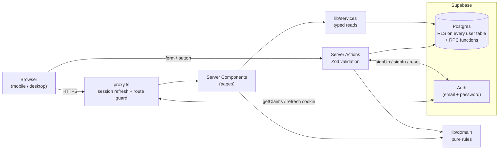

- **Hosting:** Next.js runs on Vercel (or `next start`). Supabase hosts Postgres and Auth. There's no other backend.
- **Every query uses the signed-in user's key.** The app calls Supabase with the publishable key plus the user's JWT, so Postgres RLS decides what each query can see or change. No service-role key exists.
- **Server first:** pages are Server Components that read data on the server. Only interactive pieces are client components, and they write via Server Actions.

### Layers

| Layer | Folder | Responsibility | Never does |
| --- | --- | --- | --- |
| Routing & guard | `src/proxy.ts`, `lib/supabase/proxy.ts` | Refresh the session cookie, send signed-out users to `/login?next=…` and signed-in users away from auth pages | Authorisation decisions about data (RLS does that) |
| Pages | `src/app/(tabs)`, `src/app/(flow)` | Load data and render screens (Server Components) | Compute totals inline |
| Client islands | `src/components/*` (`'use client'`) | Timers, sheets, forms, optimistic toggles | Talk to the database directly |
| Server Actions | `src/app/actions/*` | Validate with Zod, check the user, write, map errors to safe messages, revalidate | Trust ids or user ids from the client |
| Domain | `src/lib/domain` | Weeks and timezones, active minutes, streaks, goal progress, units, periods | Import React, Next or Supabase |
| Validation | `src/lib/validations` | Zod schemas shared by forms and actions | — |
| Data services | `src/lib/services/data.ts` | Typed, batched reads (no N+1), safe logging | Writes |
| Database | `supabase/migrations` | Schema, constraints, RLS, atomic RPC functions, system catalog | — |

### Folder structure

```
src/
  proxy.ts                       Next 16 proxy (formerly middleware)
  app/
    layout.tsx, globals.css      Poppins + design tokens, toast provider
    welcome, login, signup, forgot-password, setup
    auth/confirm/route.ts        email links (token-hash or PKCE code) → session
    auth/update-password         new password after a reset link
    auth/signout/route.ts        clears a stale session
    (tabs)/                      bottom bar (mobile) / side rail (desktop)
      home  workouts  exercises  activity  history  saved  profile  goals  measurements
    (flow)/                      full-screen, no tab bar
      onboarding  workouts/[id]  workouts/new  workouts/[id]/edit
      session/[id]  session/[id]/complete  history/[id]
      goals/new  goals/[id]  profile/edit  exercises/[id]  exercises/new  notifications
    actions/                     auth.ts session.ts library.ts goals.ts profile.ts
  components/
    ui.tsx overlays.tsx toast.tsx nav.tsx cards.tsx charts.tsx screen.tsx
    session-player.tsx  goal-form.tsx  workout-builder.tsx  measurements-panel.tsx  …
  lib/
    app-context.ts               user + profile + local "today" (cached per request)
    action-result.ts             ActionResult type + safe DB error mapping
    domain/                      dates.ts workouts.ts goals.ts units.ts periods.ts (+ domain.test.ts)
    validations/index.ts         Zod schemas
    services/data.ts             reads
    supabase/                    server.ts proxy.ts env.ts
  types/database.ts              typed schema for supabase-js
supabase/
  config.toml                    local stack (ports 553xx, email confirmation on)
  migrations/                    0100 schema+RLS · 0200 functions · 0300 catalog
  seed.sql                       dev-only demo account
tests/
  db/                            PGlite: migrations, constraints, RLS
  e2e/                           Playwright journeys
public/images/                   photos exported from the Figma file
docs/screenshots/                design frames used in this README
```

### Request lifecycle

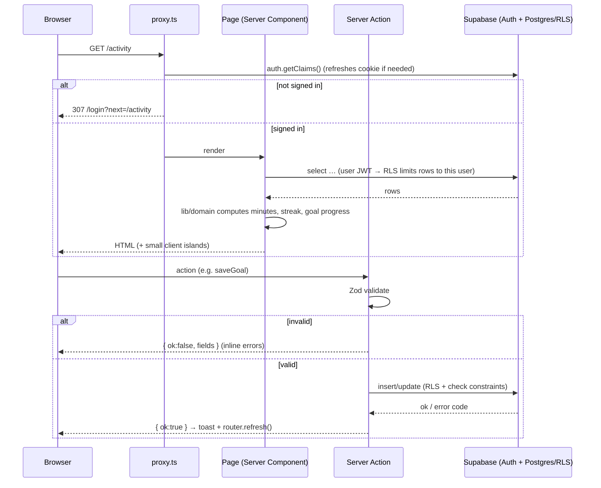

### Workout session flow

The core feature. Timing is **server-authoritative**, so the clock survives reloads, navigation and backgrounding.

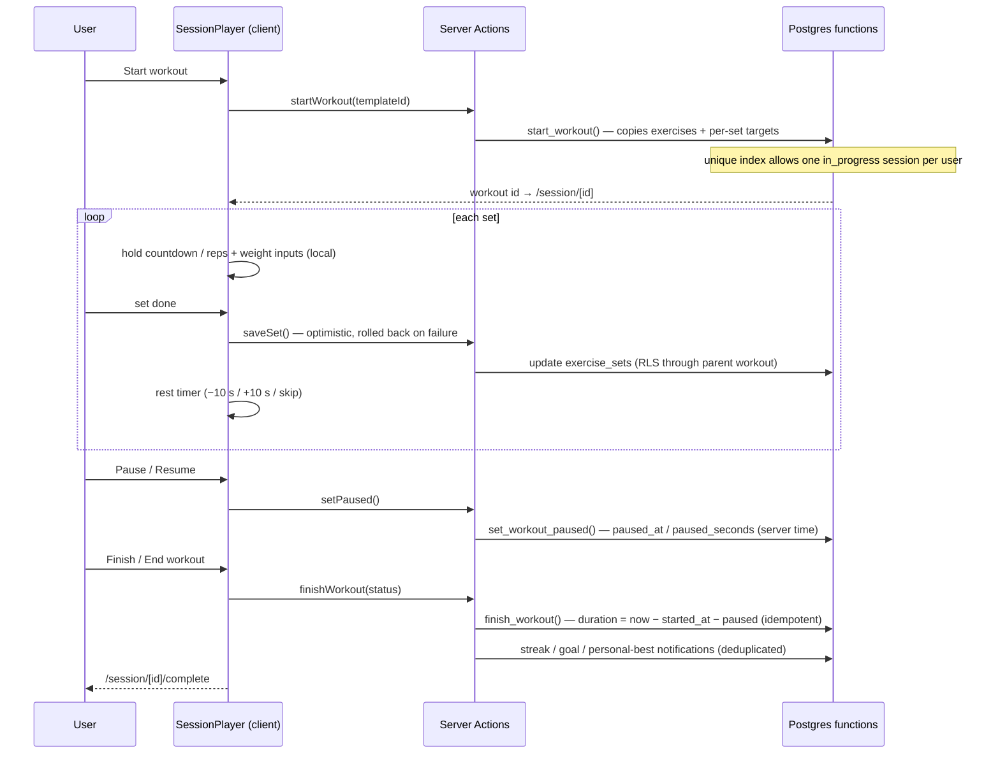

- **Statuses:** `in_progress` → `completed` (every set done) or `ended_early` (saved as a partial session). "Discard" deletes an unfinished session after a confirmation.
- **Elapsed time** = `now − started_at − paused_seconds`, corrected for client clock skew. Hold and rest countdowns are local and only pace the user.

### Data model

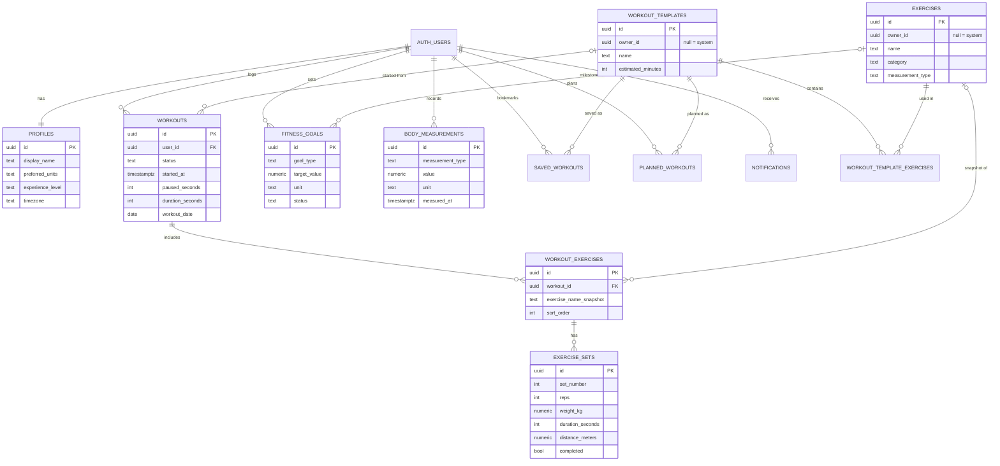

### Calculation rules (single source: `src/lib/domain`)

| Metric | Definition |
| --- | --- |
| Finished session | status `completed` or `ended_early` |
| Active minutes | sum of finished sessions' `duration_seconds` ÷ 60, rounded |
| Activity bars | day ≥ 20 min = dark, 1–19 min = grey, future preferred or planned day = dashed (monthly views use weekly bars, ≥ 60 min = dark) |
| Week | Monday–Sunday in the profile timezone |
| Streak | consecutive weeks meeting the weekly frequency goal (counts the current week once it's met) |
| Goal progress | frequency / minutes / habit: this week's sessions; milestone: best completed set; body weight: from the first weigh-in toward the target |
| Energy | MET range × body weight × hours, shown as a labelled estimate |
| Units | stored as kg / cm / m; imperial is display and input only |

### Security model

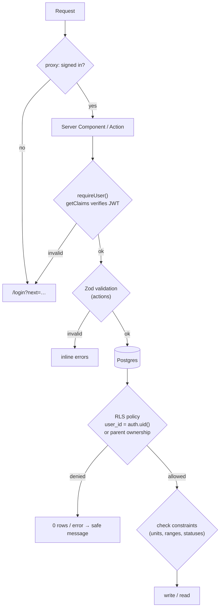

- **Ownership checks:** nested rows (`workout_exercises`, `exercise_sets`) check ownership through the parent `workouts` row. The system catalog (`owner_id is null`) is read-only.
- **RPC functions** are `SECURITY INVOKER`, so they run under the caller's RLS.
- **The `anon` role** has no table privileges.
- **Logs** record error codes only, never measurements or other personal values.

### Design fidelity

The Figma MCP was not authorised. The Figma file was opened in the browser and its plugin API used to confirm the page and export the original image fills. Layouts, tokens and type were taken from the exported frames in `~/Downloads/PulseFit` (28 screens and 4 design-system boards), not read node by node from Figma.

- **Tokens:** colours, the Poppins type scale and the spacing rules were taken from the design-system boards. They live as CSS variables in `src/app/globals.css`.
- **Photos:** exported from the Figma file's own image fills into `public/images/` (Unsplash photos, per the design notes). The −35% saturation rule is applied in CSS.
- **Changes from the design:**
  - The design is mobile-only; large screens get a side rail and a centred column.
  - The avatar shows initials. Profile photos would require Storage and uploads, which aren't built.
  - The welcome flow has one onboarding step (focus). Account details are collected on sign-up.
  - "Sign in with a passkey" isn't shown.
  - Screens with no Figma frame follow the same components and tokens: exercise library, workout builder, body measurements, sign-in/up and profile edit.

---

## Database

All user tables have RLS enabled. Ownership of nested rows is checked through the parent row, never through a user id sent by the client.

| Table | Purpose | Notes |
| --- | --- | --- |
| `profiles` | Name, units, level, focus, timezone, reminder prefs | Created by trigger on `auth.users` insert |
| `exercises` | Catalog; `owner_id null` = system, otherwise the user's own | `measurement_type`: time · reps · weight_reps · distance |
| `workout_templates` / `workout_template_exercises` | Browsable workouts and custom builds | System rows are read-only to users |
| `saved_workouts`, `planned_workouts` | Bookmarks; today's plan (one per day) | |
| `workouts` | Sessions: status, server timestamps, paused seconds, duration, effort, notes | One `in_progress` session per user (partial unique index) |
| `workout_exercises`, `exercise_sets` | Snapshot of exercises plus per-set targets and actual values | Reps, weight (`numeric`), duration, distance |
| `fitness_goals` | frequency · minutes · habit · milestone · body weight | Unit must match the type (check constraint); one active weekly goal per type |
| `body_measurements` | Weight, body fat, waist, chest, hips | Stored in kg / cm / %; ranges enforced |
| `notifications` | Streak, goal, habit and personal-best messages | `dedupe_key` unique per user |

- **Stored vs derived:** active minutes, streaks, goal progress and personal bests are always computed from sessions and sets. They are never stored.
- **Atomic operations** (`SECURITY INVOKER`, so RLS still applies):
  - `start_workout` copies a template into a session;
  - `set_workout_paused` pauses and resumes using server time;
  - `finish_workout` computes the duration on the server, and calling it twice is harmless;
  - `save_workout_template` saves a template and its exercises in one transaction.
- **Migrations:** add a new timestamped file in `supabase/migrations`. Never edit one that's already applied. Test locally with `npm run db:reset`, then push with `npx supabase db push` (see Deployment).
- **Fresh dev database:** `npm run db:reset`.

## Authentication & security

- **Flows:**
  - sign-up with email confirmation;
  - sign-in, sign-out and password reset;
  - email links land on `/auth/confirm`, which supports both the token-hash and PKCE-code formats.
- **Sessions:** `@supabase/ssr` keeps the session in cookies, and `src/proxy.ts` refreshes it on each request. Pages also verify the user server-side (`requireUser` → `auth.getClaims()`).
- **Expired or removed accounts:** a token whose account no longer exists is cleared via `/auth/signout`.
- **Keys:** only the publishable/anon key is used. There is no service-role key anywhere.
- **Headers:** security headers are set in `next.config.ts`.
- **Account deletion is not implemented.** It needs a server-only admin key or an Edge Function. All user rows cascade-delete from `auth.users`, so deleting a user in the Supabase dashboard removes their data.

## Testing

| Suite | Command | What it covers |
| --- | --- | --- |
| Domain unit tests | `npm test` | Weeks and timezones, active minutes, bar classification, streaks, server-time elapsed, energy estimate, goal progress (all types, overdue, no data), unit conversion, periods, Zod validation |
| Database tests | `npm test` | Applies the real migrations to in-process Postgres (PGlite) with a stub of Supabase `auth` and roles. Covers: catalog, profile trigger, start/finish/pause functions, one-active-session rule, constraints, cross-user RLS (read, write, update, delete, RPC) |
| E2E | `npm run db:reset && E2E_BASE_URL=http://localhost:3000 npm run test:e2e` | Protected-route redirects, a bad password, sign-in → start a workout → record a set → end early → history → edit → delete, a body-weight goal, adding and deleting a measurement, sign-out |

`npx playwright install chromium` is needed once.

## Deployment (Vercel + Supabase)

1. **Create a Supabase project.** Link it and apply the migrations. Don't run `seed.sql` in production.
   ```bash
   npx supabase link --project-ref <ref>
   npx supabase db push
   ```
2. **Supabase → Authentication → URL configuration:**
   - Site URL: `https://your-domain`;
   - Redirect URLs: `https://your-domain/**`, plus preview URLs such as `https://*-your-team.vercel.app/**` if you want auth on previews.
3. **Configure email.**
   - Auth → Providers → Email: keep "Confirm email" on.
   - Set up custom SMTP for real delivery; the built-in sender is rate-limited.
4. **Vercel → import the repo** (framework: Next.js). Set these environment variables for Production and Preview:
   - `NEXT_PUBLIC_SUPABASE_URL`;
   - `NEXT_PUBLIC_SUPABASE_PUBLISHABLE_KEY`;
   - `NEXT_PUBLIC_SITE_URL` = the deployment's URL.

   Use a separate Supabase project for staging if you want isolated data.
5. **Deploy, then check:** sign-up email → confirm → onboarding → start and finish a workout.

## Troubleshooting

- **Every page redirects to `/setup`:** the Supabase environment variables are missing. Restart the dev server after editing `.env.local`.
- **The confirmation link opens the wrong host, or sign-in fails after clicking it:** `NEXT_PUBLIC_SITE_URL` must match the host you use, and that host must be in the Supabase Redirect URLs. Locally, `supabase/config.toml` → `[auth] additional_redirect_urls`.
- **`supabase start` reports a port already allocated:** another local Supabase project is running. Stop it, or change the ports in `supabase/config.toml`.
- **"Email or password is incorrect" for a new account:** confirm the email first. Locally, check Mailpit.
- **Weeks or days look shifted:** set your timezone in Profile → Edit profile. Days and weeks follow the profile timezone, with Monday as the first day of the week.

## Known limitations

- **Reminders:** reminder preferences are stored and shown in-app, but no push or email reminders are sent; that needs a scheduler and a provider.
- **Notifications** are created when a workout ends (streak, weekly goal, habit, personal best). The demo's reminder and weekly-summary rows come from the seed.
- **Hold and rest countdowns** are local to the open tab. The session's elapsed time and pauses are server-authoritative.
- **Exercise catalog:** sample programming written for this app; there's no external exercise API.
- **Not built:** workout scheduling beyond "planned for today", profile photos and account deletion.
